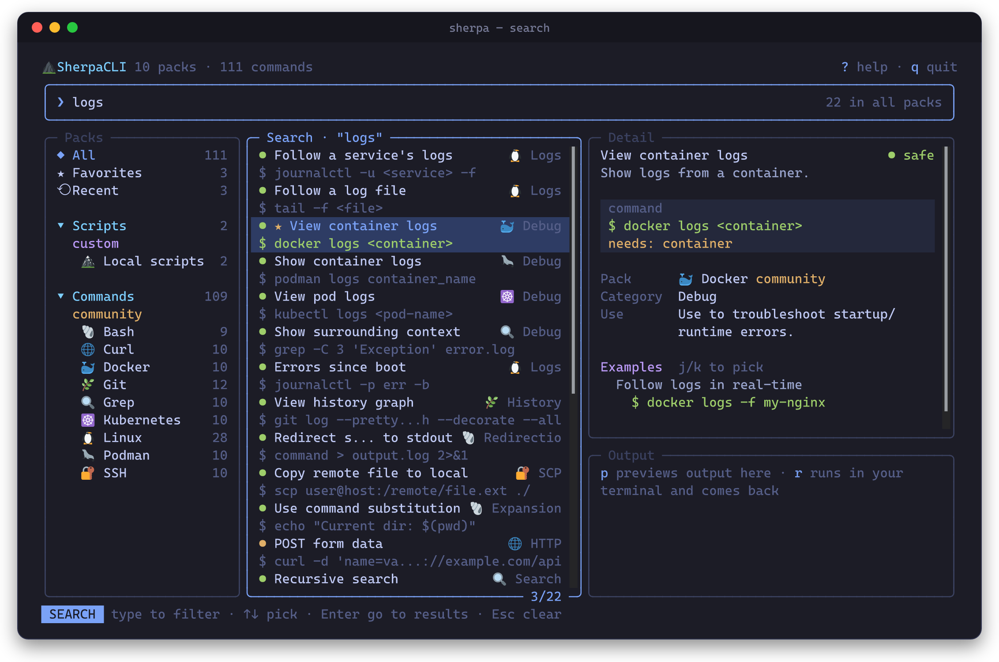
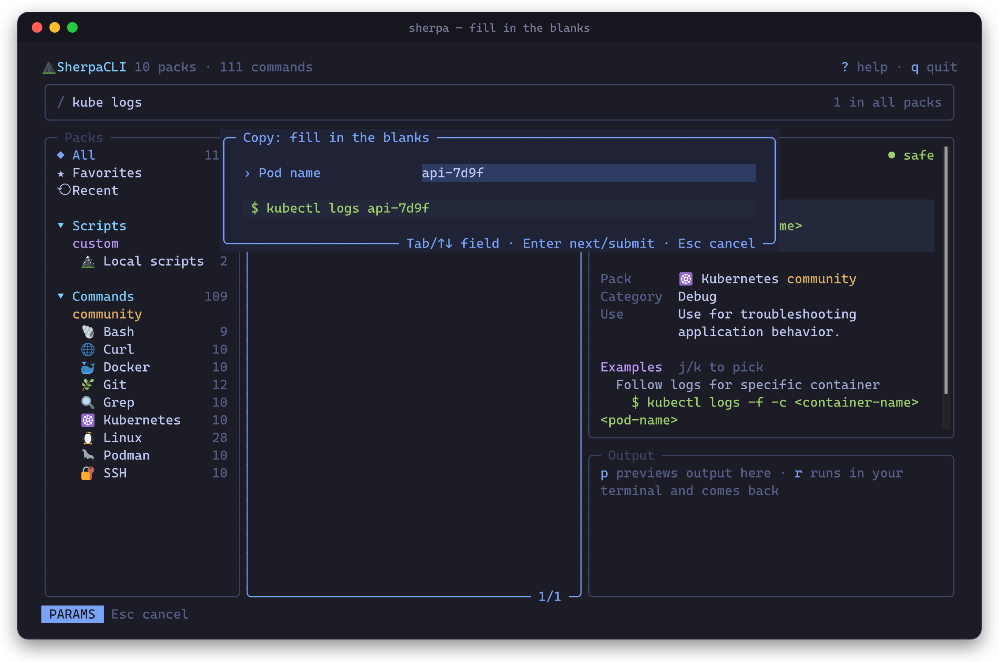
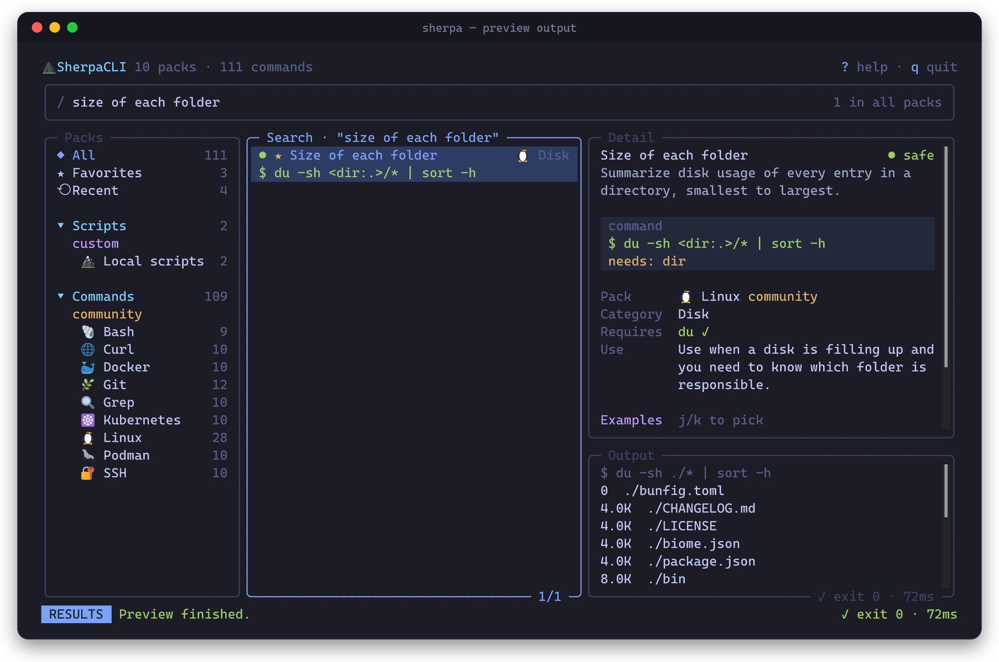
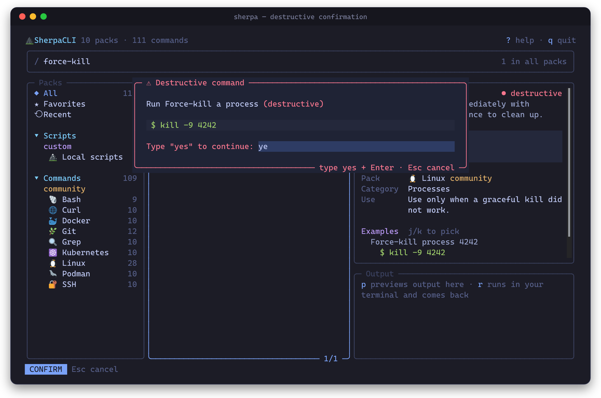

# SherpaCLI

A keyboard-first command and cheat sheet assistant for your terminal.

Search a few words, see the command with an explanation, fill in the blanks, then copy it, preview its output, or run it.
Bundled packs cover Docker, Podman, Kubernetes, Git, Linux, SSH, curl, grep and Bash.
You can import more from [quickref.me](https://quickref.me) / [cheatsheets.zip](https://cheatsheets.zip) or write your own,
including packs for your personal scripts.

Built with [OpenTUI](https://opentui.com/docs/getting-started/), [SolidJS](https://docs.solidjs.com/), TypeScript and [Bun](https://bun.sh).
It works offline. Nothing leaves your machine unless you run `sherpa import`.



## Contents

- [Features](#features)
- [Requirements](#requirements)
- [Install](#install)
- [Using Sherpa](#using-sherpa)
- [Import cheat sheets](#import-cheat-sheets)
- [Add your own commands and scripts](#add-your-own-commands-and-scripts)
- [Command-line reference](#command-line-reference)
- [Files and configuration](#files-and-configuration)
- [Troubleshooting](#troubleshooting)
- [Development](#development)
- [License](#license)

## Features

- **Search-first.** Type a few words (`kube logs`, `docker prune`) and every pack is searched. Use `pack:git` to narrow to one pack.
- **Fill in the blanks.** Commands like `kubectl logs <pod-name>` open a small form before you copy or run them.
  Sherpa remembers the last value you typed for each field.
- **Run and come back.** `r` hands the terminal to the command, then returns you to the same spot.
  `p` previews the output inside Sherpa.
- **Safety levels.** Each command is marked `safe`, `caution` or `destructive`.
  `caution` asks for `y` before running; `destructive` makes you type `yes`.
- **Favorites and recents.** Press `f` to star a command. Recently used commands are tracked automatically.
- **Your scripts too.** Script packs can point at files in `/usr/local/bin`, prompt for arguments, or offer a menu of options.
- **Cheat sheet import.** `sherpa import docker kubernetes` turns quickref.me sheets into local packs.

### Screenshots

| Fill in the blanks before copying or running | Preview output without leaving Sherpa |
| --- | --- |
|  |  |

| Destructive commands ask you to type `yes` |
| --- |
|  |

## Requirements

- **Linux, macOS or WSL**, in a terminal with true color and Unicode (most modern terminals).
- **[Bun](https://bun.sh) 1.4 or newer**: `curl -fsSL https://bun.sh/install | bash`
- **bash**, used to run commands.
- **Optional, for copying:** `wl-copy` (Wayland), `xclip` or `xsel` (X11), `pbcopy` (macOS) or `clip.exe` (WSL).
  Without one, Sherpa falls back to the terminal's OSC 52 clipboard, which works in most modern terminals and over SSH.

## Install

```bash
git clone https://github.com/cjrdz/sherpacli.git
cd sherpacli
bun install
```

Try it from the repository:

```bash
bun run sherpa
```

Then make `sherpa` available everywhere by linking the launcher into a folder on your `PATH`:

```bash
mkdir -p "$HOME/.local/bin"
ln -sf "$(pwd)/bin/sherpa" "$HOME/.local/bin/sherpa"
sherpa --version
```

If `sherpa` is not found, add `export PATH="$HOME/.local/bin:$PATH"` to your `~/.bashrc` or `~/.zshrc` and open a new shell.

To update later, run `git pull && bun install` in the clone. The link keeps working.

## Using Sherpa

Start it with `sherpa`. The screen has four panels:

| Panel | What it shows |
| --- | --- |
| **Packs** | All commands, ★ Favorites, ⟲ Recent, then each pack grouped by kind (Scripts / Commands) and scope (custom / default / community) |
| **Results** | The commands in the selected pack, or your search results. The dot shows the safety level |
| **Detail** | The command, what it needs, required tools (✗ if not installed), and examples you can pick with `j`/`k` |
| **Output** | Output from a preview (`p`), with exit code and duration |

### A typical flow

1. Press `/` and type what you're looking for, for example `docker logs`.
2. Press `↓`/`↑` to pick a result, or `Enter` to move to the results list.
3. Press `c` to copy, `p` to preview, or `r` to run.
4. If the command has placeholders, fill them in (`Tab` moves between fields) and press `Enter`.
5. After `r`, the command runs in your terminal. Press any key to come back to Sherpa.

Commands run in the directory where you launched `sherpa`.

### Keys

| Key | Action |
| --- | --- |
| `/` | Search every pack |
| `↑ ↓` or `j k` | Move in the active panel (in Detail, pick an example) |
| `PgUp PgDn`, `g G` | Jump a page, or to the start or end |
| `Tab`, `← →` or `h l` | Switch panel |
| `Enter` | Open a pack · show details · copy |
| `Space` | Expand or collapse a group in Packs |
| `c` | Copy the command |
| `p` | Preview the output (stops after 10 seconds) |
| `r` | Run in your terminal, then return |
| `f` | Star or unstar a favorite |
| `?` | Show all shortcuts |
| `Esc` | Close a dialog · clear the search · go back (it never quits) |
| `q` or `Ctrl+C` | Quit |

While typing in the search box, letters go to the search. Only `Esc`, `Enter`, `Tab`, arrows and page keys are shortcuts.

### Search tips

- Words are combined: `kube logs` matches commands containing both.
- Search looks at the name, command, tags, examples, description, category and pack name.
- `pack:docker prune` searches only packs whose id or name starts with `docker`.
- `Esc` clears the search. Pressing it again leaves the search box.

### Placeholders

A command with `<name>`, `<name:default>` or `{{name}}` opens a form before you copy, preview or run it.
The form shows the final command as you type.
Fields with a default can be left empty. Sherpa remembers the last value for each field name, so the next `<pod-name>` is pre-filled.

### Safety levels

| Level | Shown as | Before `p` or `r` |
| --- | --- | --- |
| `safe` | green ● | Runs right away |
| `caution` | yellow ● | Asks you to press `y` |
| `destructive` | red ● | Asks you to type `yes` and press `Enter` |

Copying never asks. When you run a command with `r`, `Ctrl+C` stops the command, not Sherpa.

## Import cheat sheets

[quickref.me](https://quickref.me) and [cheatsheets.zip](https://cheatsheets.zip) are both built from the
[Fechin/reference](https://github.com/Fechin/reference) markdown files. Sherpa can convert them into packs:

```bash
sherpa import --list                    # show the ~200 available sheets
sherpa import docker kubernetes git     # download, convert, validate and save
sherpa import tmux --dry-run            # show what would be imported
sherpa import docker --force            # re-import over an existing pack
sherpa import --file ./my-notes.md      # convert your own markdown in the same format
```

Imported packs are saved to `~/.config/sherpa/packs/commands/community/` and appear under **Commands › community**
the next time you start Sherpa. While converting, Sherpa:

- picks up commands from tables and shell code blocks, with their descriptions
- turns `[name]` into a `<name>` placeholder you can fill in
- sets a safety level from the command (`rm`, `prune`, `--force`, `reset --hard`, …). Review destructive commands before trusting them.

The upstream content is licensed GPL-3.0. Imports stay on your machine and are never added to this repository.

## Add your own commands and scripts

Put packs in `~/.config/sherpa/packs/`. They load next to the bundled packs, and a pack with the same `id` replaces a bundled one.

```text
~/.config/sherpa/packs/
├── commands/
│   └── custom/my-tools.json
└── scripts/
    └── custom/my-scripts.json
```

A command pack:

```json
{
	"pack": {
		"id": "my-tools",
		"name": "My tools",
		"version": "1.0.0",
		"description": "Commands I always forget",
		"icon": "🧰",
		"author": "me",
		"tags": ["personal"]
	},
	"commands": [
		{
			"id": "tail-app-log",
			"name": "Follow the app log",
			"description": "Stream the application log of an environment.",
			"command": "ssh <host:prod-1> 'tail -f /var/log/app/<service>.log'",
			"use_case": "Use while reproducing a bug on a server.",
			"category": "Logs",
			"tags": ["ssh", "logs"],
			"examples": [{ "description": "Follow the API log", "command": "ssh prod-1 'tail -f /var/log/app/api.log'" }],
			"danger_level": "safe"
		}
	]
}
```

A script pack, for tools you keep in `/usr/local/bin`:

```json
{
	"pack": {
		"id": "my-scripts",
		"name": "My scripts",
		"version": "1.0.0",
		"description": "Personal maintenance scripts",
		"icon": "🔧",
		"author": "me",
		"tags": ["scripts"]
	},
	"scripts": [
		{
			"id": "backup-home",
			"name": "Back up home",
			"description": "Sync my home folder to a backup disk.",
			"category": "Maintenance",
			"tags": ["backup", "rsync"],
			"requires": ["rsync"],
			"danger_level": "caution",
			"execution": {
				"type": "file",
				"path": "/usr/local/bin/backup-home",
				"args": [{ "name": "target", "prompt": "Backup folder", "default": "/mnt/backup" }]
			}
		}
	]
}
```

Run `sherpa` again to see your packs. The full reference, including menu scripts and every field, is in
[docs/PACK_FORMAT.md](docs/PACK_FORMAT.md). To share a pack with everyone, add it under `packs/` and open a pull request
(see [docs/CONTRIBUTING.md](docs/CONTRIBUTING.md)).

## Command-line reference

| Command | Description |
| --- | --- |
| `sherpa` | Open the TUI |
| `sherpa import <sheet>...` | Import cheat sheets. Options: `--list`, `--file <path>`, `--dry-run`, `--force` |
| `sherpa migrate` | Move flat pack files in `packs/` into scoped folders. Options: `--apply`, `--dry-run`, `--force`, `--json`, `--target commands\|scripts\|all`, `--from flat\|scoped\|auto` |
| `sherpa --version` | Print the version |
| `sherpa --help` | List commands. `sherpa <command> --help` shows options for one command |

`sherpa migrate` only previews changes unless you pass `--apply`. With `--apply`, it exits with code 1 when there are
conflicts (unless `--force`) or when the migrated packs fail validation.

## Files and configuration

| Path | Purpose |
| --- | --- |
| `~/.config/sherpa/state.json` | Favorites, recent commands and remembered placeholder values |
| `~/.config/sherpa/packs/` | Your own and imported packs |
| `packs/` (in the repository) | Bundled packs |
| `schemas/` (in the repository) | JSON schemas used to validate packs |

`$XDG_CONFIG_HOME` is respected: if it is set, Sherpa uses `$XDG_CONFIG_HOME/sherpa/`.
Deleting `state.json` resets favorites and history. A damaged file is ignored rather than stopping Sherpa.

## Troubleshooting

- **"No clipboard available"**: install `wl-copy`, `xclip` or `xsel`, or use a terminal that supports OSC 52.
- **Boxes or emoji look misaligned**: use a font with emoji support and a terminal with full Unicode width handling
  (for example WezTerm, Kitty, Ghostty or Windows Terminal).
- **A preview stops after 10 seconds**: streaming commands such as `logs -f` or `watch` never finish on their own. Use `r` to run them.
- **An imported command does the wrong thing**: imported safety levels and descriptions are best-effort.
  Check the command in the Detail panel, edit the pack JSON, or re-import with `--force`.
- **`sherpa: command not found`**: check that the folder you linked into is on your `PATH` (see [Install](#install)).

## Development

```bash
bun install
bun run dev          # run the TUI from source
bun run test         # unit and UI tests (headless renderer)
bun run check        # type-check
bun run lint         # Biome lint
bun run format       # Biome format
bun run validate     # validate every pack in packs/ against schemas/
```

Repository layout:

```text
apps/tui/src/
├── main.tsx            entry point and subcommands
├── app.tsx             layout, navigation and state wiring
├── actions.ts          copy / preview / run pipeline (menu → form → confirm → execute)
├── theme.ts            colors
├── components/         panels, status bar, dialogs
├── hooks/              keyboard map, search
├── store/              app state
└── core/               pack loading, runner, placeholders, user data, importer, migration
packs/                  bundled command and script packs
schemas/                JSON schemas for packs
docs/                   pack format and contributing guide
```

See [docs/CONTRIBUTING.md](docs/CONTRIBUTING.md) for the workflow and the release process, and [CHANGELOG.md](CHANGELOG.md) for release notes.

## License

[MIT](LICENSE). Cheat sheets imported with `sherpa import` keep their upstream license (GPL-3.0) and stay on your machine.
